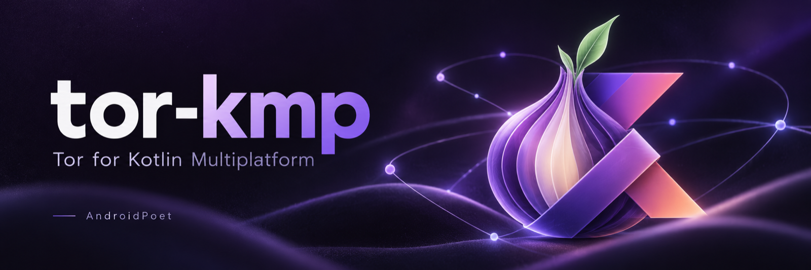

<p align="center">
  
</p>

<p align="center"><b>An embedded Tor client for Kotlin Multiplatform, built on Arti.</b></p>

<p align="center">
  <a href="https://central.sonatype.com/artifact/io.github.androidpoet/tor"></a>
  <a href="https://kotlinlang.org"></a>
  <a href="https://gitlab.torproject.org/tpo/core/arti"></a>
  <a href="LICENSE"></a>
</p>

<p align="center">
  
  
  
  
  
  
</p>

<p align="center">
One Kotlin API; the Tor client runs <i>inside your process</i>.
<a href="https://gitlab.torproject.org/tpo/core/arti">Arti</a>, the Tor Project's Rust implementation,
ships as a native library for Android, iOS, macOS, Linux and Windows, and inside the JVM jar.
No Orbot, no bundled <code>tor</code> process, no control port.
</p>

<p align="center">
  <a href="#install">Install</a> ·
  <a href="#quickstart">Quickstart</a> ·
  <a href="#choose-a-transport">Transports</a> ·
  <a href="#platform-notes">Platforms</a> ·
  <a href="#isolation-and-new-identity">Isolation</a> ·
  <a href="#errors-timeouts-cancellation">Errors</a> ·
  <a href="#what-it-is-and-what-it-is-not">What it is not</a> ·
  <a href="#which-client-which-path">Client matrix</a> ·
  <a href="#testing-your-app">Testing</a> ·
  <a href="#faq">FAQ</a> ·
  <a href="#alternatives">Alternatives</a> ·
  <a href="#versioning-and-arti-upgrades">Versioning</a> ·
  <a href="#build--test">Build</a>
</p>

## Install

In the `commonMain` dependencies of a Kotlin Multiplatform module (or `dependencies {}` of an
Android or JVM module):

```kotlin
implementation("io.github.androidpoet:tor:0.2.0")          // the client: streams, TLS, SOCKS, bridges
implementation("io.github.androidpoet:tor-ktor:0.2.0")     // optional: a Ktor engine, no proxy
implementation("io.github.androidpoet:tor-okhttp:0.2.0")   // optional: OkHttp on Tor sockets (Android, JVM)
implementation("io.github.androidpoet:tor-lyrebird:0.2.0") // optional: obfs4/webtunnel/snowflake client (Android, JVM)
```

The artifacts are on Maven Central (`repositories { mavenCentral() }`). The native Tor
client is inside each one; there is nothing else to add, link or download. Built with
Kotlin 2.2.21, so your project needs Kotlin 2.2.21 or newer to read the klibs; Android
API 24+. `tor-ktor` is built and tested against Ktor 3.3.3; `tor-okhttp` against OkHttp
5.3.2. If your app declares a newer version, Gradle resolves to yours, and binary
compatibility with it is then yours to verify.

## Quickstart

The raw stream API first, because every transport below is built on it. If you only need an
HTTP client, skim this and jump to [Choose a transport](#choose-a-transport). Keep one
`Tor` per app; its data directory must be app-private (paths per platform under
[Platform notes](#platform-notes)). The first `connect()` bootstraps, 20–40 s on a cold
directory.

```kotlin
import io.github.androidpoet.tor.Tor
import io.github.androidpoet.tor.TorConfig

val tor = Tor(TorConfig(dataDirectory = "$appPrivateDir/tor"))

suspend fun fetchThroughTor(): String {
    tor.connect("example.com", 80).use { stream ->
        stream.write("GET / HTTP/1.1\r\nHost: example.com\r\nConnection: close\r\n\r\n".encodeToByteArray())
        val buffer = ByteArray(16 * 1024)
        val response = StringBuilder()
        while (true) {
            val count = stream.read(buffer)
            if (count < 0) break
            response.append(buffer.decodeToString(0, count))
        }
        return response.toString()
    }
}
```

Watch it connect and tell the user what is happening:

```kotlin
import io.github.androidpoet.tor.BlockageKind
import io.github.androidpoet.tor.TorState
import kotlinx.coroutines.launch

uiScope.launch {
    tor.state.collect { state ->
        when (state) {
            TorState.Idle -> {}
            is TorState.Bootstrapping -> {
                val blockage = state.blockage
                val hint =
                    when (blockage?.kind) {
                        null -> "Connecting to Tor… ${(state.progress * 100).toInt()}%"
                        BlockageKind.OFFLINE -> "No internet connection"
                        BlockageKind.FILTERING -> "This network seems to block Tor"
                        BlockageKind.CLOCK_SKEWED -> "Check the device clock"
                        else -> blockage.message
                    }
                show(hint)
            }
            TorState.Ready -> show("Connected")
            is TorState.Failed -> show("Tor failed: ${state.error.message}")
            TorState.Closed -> {}
        }
    }
}
```

`.onion` addresses work out of the box, and hostnames are resolved by the exit relay, so no
DNS query for them leaves the device. For HTTP you will not write requests by hand; read on.

## Choose a transport

| You have | Use | Port opened | Isolation |
| --- | --- | --- | --- |
| Your own protocol code | `tor.connect()` / `tor.connectTls()` | none | `isolation =` argument |
| Ktor, any target | `HttpClient(TorEngine)` from `tor-ktor` | none | `isolation` per client |
| OkHttp (or Ktor's `OkHttp` engine) | `OkHttpClient.Builder().tor(tor)` from `tor-okhttp` | none | `isolation` per client |
| A WebView, or an HTTP stack you can't change | `tor.startSocksProxy()` | `127.0.0.1:<port>` | SOCKS username |

### Streams

```kotlin
tor.connect("example.com", 80)                 // plain TCP over Tor
tor.connectTls("example.com", 443)             // TLS already done inside the Tor client
```

`connectTls` verifies the certificate against Mozilla's root store (bundled, so it is the
same on every platform) and negotiates `http/1.1`. It is a convenience for simple clients;
for certificate pinning, your platform's trust store or client certificates, do TLS yourself
on top of `connect()`, which is exactly what `tor-okhttp` does.

### Ktor (`tor-ktor`, every target)

```kotlin
import io.github.androidpoet.tor.Isolation
import io.github.androidpoet.tor.ktor.TorEngine
import io.ktor.client.HttpClient
import io.ktor.client.request.get
import io.ktor.client.statement.bodyAsText

val client = HttpClient(TorEngine) {
    engine {
        tor = myTor
        isolation = Isolation("account-1")   // optional
    }
}

suspend fun whoAmI(): String = client.get("https://check.torproject.org/api/ip").bodyAsText()
```

HTTP/1.1 with keep-alive, request bodies, WebSockets (install Ktor's `WebSockets` plugin and
call `client.webSocket("wss://…")` as usual, onion hosts included), `HttpTimeout`'s connect
timeout and every Ktor plugin that sits on top of an engine (content negotiation, logging,
auth, retry). TLS is done inside the Tor client against Mozilla's roots; there is no platform
trust store or pinning here. Not supported: HTTP/2.

### OkHttp (`tor-okhttp`, Android and JVM)

```kotlin
import io.github.androidpoet.tor.Isolation
import io.github.androidpoet.tor.okhttp.tor
import okhttp3.OkHttpClient

val client = OkHttpClient.Builder().tor(myTor, isolation = Isolation("account-1")).build()
```

OkHttp keeps doing TLS itself (platform trust store, `CertificatePinner`, HTTP/2 via ALPN);
only the TCP layer is a Tor stream. `TorDns` hands hostnames to Tor unresolved, so `.onion`
hosts work and no DNS query leaves the device. The same client serves Ktor's `OkHttp` engine
through `engine { preconfigured = client }`.

In both adapters the connect timeout (`connectTimeout` / `HttpTimeout.connectTimeoutMillis`)
bounds opening the Tor stream, like a TCP connect. It does not cover Tor's first bootstrap,
which runs before it; call `tor.bootstrap()` yourself to bound or display that.

### SOCKS proxy

```kotlin
val proxy = tor.startSocksProxy()                 // port 0: any free port; a random password
proxy.url(Isolation("tab-1"))                     // socks5h://tab-1:<password>@127.0.0.1:41823
proxy.url()                                       // socks5h://:<password>@127.0.0.1:41823, the default group
proxy.close()                                     // or tor.stopSocksProxy()

tor.startSocksProxy(auth = SocksAuth.None)        // only for clients that cannot authenticate
```

- **Authenticated by default.** A loopback port is reachable by every process on the
  device, so the proxy generates a 192-bit password (`SocksAuth.Generated`) and refuses
  anyone who does not present it (RFC 1929); the username is the isolation key. Pass
  `SocksAuth.Password("…")` to choose it, or `SocksAuth.None` for a client that cannot send
  credentials: Chromium WebViews cannot, so Android WebView needs an open proxy. Keep its
  lifetime short and `close()` it when the WebView goes away.
- **Isolation over SOCKS needs credentials on the wire.** `url(Isolation("tab-1"))` puts
  them in the URL; a client that connects without authenticating lands in the default group
  even if you started the proxy with `SocksAuth.None`.
- It speaks **SOCKS5 `CONNECT`** with hostname, IPv4 and IPv6 addresses. No `BIND`, no
  `UDP ASSOCIATE`, no SOCKS4. Credentials are 1–255 bytes each (SOCKS5's limit).
- **Hostnames must reach the proxy unresolved** (`socks5h://`, "proxy DNS"). A client that
  resolves names itself leaks every lookup outside Tor. `tor.socksIpLiteralConnections`
  counts requests that arrived with an IP literal; if it climbs while you use a client, that
  client resolves locally. [Which client, which path](#which-client-which-path) lists the
  ones that are known to.
- `startSocksProxy()` a second time returns the running proxy, whatever the arguments.

## Bridges and censorship

On a network that blocks the public relays, `state` stays in `Bootstrapping` with
`BlockageKind.FILTERING`. Bridges are unlisted relays; pluggable transports disguise the
connection to them. Users get bridge lines from <https://bridges.torproject.org>, the
Telegram bot `@GetBridgesBot` or by emailing `bridges@torproject.org`, and your app passes
them in:

```kotlin
import io.github.androidpoet.tor.Bridge
import io.github.androidpoet.tor.TorConfig
import io.github.androidpoet.tor.lyrebird.Lyrebird
import io.github.androidpoet.tor.lyrebird.transport

val tor =
    Tor(
        TorConfig(
            dataDirectory = "$appPrivateDir/tor",
            bridges = userBridgeLines.map(Bridge::parse),       // IllegalArgumentException names a bad line
            transports = listOf(Lyrebird.transport(context)),    // Android; Lyrebird.transport() on the JVM
        ),
    )
```

- **Direct bridges** (`Bridge 1.2.3.4:443 FINGERPRINT`) need no transport and work on every
  target, iOS included.
- **obfs4, webtunnel, meek_lite, snowflake** lines need a pluggable-transport client, a
  separate executable Arti launches and talks to. `tor-lyrebird` bundles the Tor Project's
  lyrebird 0.8.1 for Android (as `liblyrebird.so`, run from the app's native-library
  directory, the one place Android 10+ still allows an app to execute from) and for the JVM
  on macOS, Linux and Windows (unpacked to `~/.cache/tor-kmp/lyrebird-0.8.1` on first use,
  re-verified by SHA-256 on every launch). It adds 13–19 MB per architecture. On Android the
  app module must ask for native libraries to be extracted at install time, since a library
  cannot set that for it:

  ```kotlin
  android {
      packaging { jniLibs { useLegacyPackaging = true } }
  }
  ```
 Any other PT 1.0 client works through `PluggableTransport(protocols,
  executablePath)`.
- **iOS** cannot run a child process, so `TorConfig` rejects transports there. Direct
  bridges still work; a built-in transport is on the roadmap.
- With a non-empty bridge list Arti uses **only** the bridges. `Bridge.parse` validates each
  line with Arti's own parser, and `TorConfig` checks that every transport a line names is
  provided, so mistakes surface before any network activity.
- Give users **several bridge lines**. Arti keeps retrying a bridge whose obfs4 handshake
  fails, so a single dead bridge leaves `bootstrap()` at a few percent indefinitely; wrap
  it in `withTimeout` and watch `progress` if you need to give up. The three built-in
  obfs4 lines from `bridges.torproject.org/moat/circumvention/builtin` bootstrap in about
  80 s in this repo's tests.

## Platform notes

| Platform | Data directory | Notes |
| --- | --- | --- |
| Android | `context.filesDir.resolve("tor").path` | `INTERNET` is declared in the library manifest and merged into yours. Consumer R8/ProGuard rules ship in the AAR. A backgrounded process may be killed: run `Tor` in a foreground service if it must stay up (messenger, long download); otherwise create it again on the next launch, which is fast with a warm directory. |
| iOS | `NSFileManager` `applicationSupportDirectory` + `/tor` | The native library is a static archive inside the klib and is linked into your framework by the Kotlin compiler; nothing to add in Xcode. No special entitlement for outbound connections. The process is suspended in the background and its connections drop; keep the `Tor` instance and the next `connect()` after resuming rebuilds circuits from the cached directory. |
| macOS (Kotlin/Native) | `~/Library/Application Support/<app>/tor` | Same linking story as iOS. A sandboxed app needs the `com.apple.security.network.client` entitlement for any outbound socket, Tor included. |
| JVM / Compose Desktop | a directory under the user's home or `java.io.tmpdir` | The jar carries `libtorkmp` for macOS (arm64, x64), Linux (arm64, x64) and Windows (x64); the right one is extracted to a temporary file and loaded on first use. |
| Linux (Kotlin/Native) | `$XDG_DATA_HOME/<app>/tor` | glibc 2.17 or newer. |
| Windows (`mingwX64`) | `%LOCALAPPDATA%\<app>\tor` | Builds and links; see the verification table for what has been executed. |

Pick a location the OS backs up **nothing** from: the directory holds Tor's directory cache
and guard choice, which make bootstrapping fast but also mean two launches with the same
directory are the same Tor client. Delete it when the user asks to start over.

### Targets and verification

| Platform | Gradle targets | Native library | Live tests last run (0.1.1, locally) |
| --- | --- | --- | --- |
| Android (API 24+) | `androidTarget` (`arm64-v8a` `armeabi-v7a` `x86_64` `x86`) | `libtorkmp.so` in the AAR | API 36 emulator, `x86_64` |
| iOS | `iosArm64` `iosSimulatorArm64` `iosX64` | static, inside the klib | iPhone 17 simulator (arm64) |
| macOS | `macosArm64` `macosX64` | static, inside the klib | Apple silicon |
| JVM | `jvm` | five libraries inside the jar | macOS, Apple silicon |
| Linux | `linuxX64` `linuxArm64` | static, inside the klib | Debian 12 containers, both architectures |
| Windows | `mingwX64` | static, inside the klib | compiled and linked only, never executed |

The live tests fetch an onion service and `check.torproject.org` through the real Tor
network. The platform runs in the table happen **locally before each release**, on the
machines listed. CI ([`build.yml`](.github/workflows/build.yml), pull requests and manual
runs only) covers less: formatting, detekt, `apiCheck` across every target (which builds
the Rust core for each) and the `tor` module's JVM live tests on a macOS runner. Treat the
table as the maintainer's last run, not as continuous assurance.

### Size

Native library sizes as listed by `unzip -l` on the 0.1.1 Maven Central artifacts (the
Android AAR's `jni/` entries and the JVM jar's bundled libraries; release build with LTO,
symbols stripped). Each app ships only its own architectures.

| Android `arm64-v8a` | `armeabi-v7a` | `x86_64` | `x86` | macOS arm64 | macOS x64 | Linux arm64 | Linux x64 | Windows x64 |
| --- | --- | --- | --- | --- | --- | --- | --- | --- |
| 5.4 MB | 3.9 MB | 6.2 MB | 5.9 MB | 4.3 MB | 5.1 MB | 5.5 MB | 6.3 MB | 5.6 MB |

The JVM jar is the sum of its five desktop libraries (about 27 MB). iOS and Native
binaries add roughly the arm64 figure to your app after linking.

## Isolation and new identity

Tor keeps unrelated activity on separate circuits. Pass an `Isolation` key per tab, account
or conversation; the key becomes an Arti isolation group, and Arti never places streams from
different groups on the same circuit. Streams with the same key may share one:

```kotlin
tor.connect("example.com", 80, isolation = Isolation("tab-1"))
tor.connect("example.com", 80, isolation = Isolation("tab-2"))
tor.connect("example.com", 80, isolation = Isolation.random())   // linkable to nothing else

proxy.url(Isolation("tab-1"))

tor.newIdentity()
```

`Isolation` validates its key (1–255 UTF-8 bytes, no NUL: it doubles as a SOCKS username)
and `Isolation.random()` draws 128 bits from the OS. The key is not a secret.

This separates **circuits**, not application state. Reusing a key across accounts that must
stay unlinkable undoes it, and cookies, caches and sessions are your app's to keep apart.

`newIdentity()` is circuit rotation only. It does not clear cookies, caches, sessions or
anything else your app or a WebView remembers; do that yourself at the same time. Unlike the
C Tor daemon's `NEWNYM`, it is not rate-limited.

Pooled HTTP connections are covered: each call bumps `tor.identityGeneration`, and
`tor-ktor` and `tor-okhttp` retire idle connections opened under an older generation, so a
request issued after `newIdentity()` returns does not pick up a pre-rotation connection from
the pool. A request that had already taken a connection when you called it (in flight, or
between the pool's check and the first byte) finishes on that circuit; if that matters,
wait for outstanding calls before rotating. If you pool connections yourself, record the
generation when you open one and drop it when the value changes.

## Errors, timeouts, cancellation

Everything that fails in Tor throws `TorException` with Arti's explanation; the HTTP
adapters wrap it in their own `IOException`s. `state` shows the same failures as
`TorState.Failed` when they happen during bootstrap.

```kotlin
import io.github.androidpoet.tor.TorException
import kotlinx.coroutines.TimeoutCancellationException
import kotlinx.coroutines.withTimeout

suspend fun fetchOrExplain(): String =
    try {
        withTimeout(90_000) { tor.bootstrap() }             // bound the slow part separately
        withTimeout(30_000) { tor.connectTls("example.com") }.use { stream -> readAll(stream) }
    } catch (e: TorException) {
        "Tor: ${e.message}"                                 // e.g. "connect to example.com:443 failed: …"
    } catch (e: TimeoutCancellationException) {
        "Tor is taking too long; check tor.state.value for a Blockage"
    }
```

- Cancelling a coroutine stops the native work: a cancelled `bootstrap()` stops Arti's
  bootstrap, and a cancelled `read()`/`write()` closes its stream. A cancelled `connect()`
  returns once the native connect finishes or fails, so wrap it in `withTimeout` for a hard
  bound.
- `tor-okhttp` follows socket semantics: OkHttp's connect and read timeouts apply, coroutine
  cancellation does not reach a blocked `Socket` call.
- `close()` on `Tor` cancels any bootstrap and stops the proxy; it is idempotent. Open
  `TorStream`s keep working until you close them. Afterwards `state` is `Closed`;
  `bootstrap()`, `connect()`, `connectTls()` and `startSocksProxy()` throw
  `TorException("Tor is closed")`, while `newIdentity()` and `stopSocksProxy()` do nothing.
  Close your `HttpClient`s and `OkHttpClient` pools first, then `Tor`: neither adapter closes
  the `Tor` it was given.
- `bootstrap()` is optional: `connect()` and `startSocksProxy()` call it for you.

## What it is, and what it is not

tor-kmp routes **the connections you hand it** through the Tor network. That is the whole
promise, and it is worth being exact about:

- It is **not a VPN or a kill switch.** Any other socket your app (or a library in it) opens
  still goes straight to the internet. If "never direct" is a requirement, centralise your
  networking on `Tor`, `tor-ktor` or `tor-okhttp`, and fail closed when Tor is unavailable.
- It is **not Tor Browser.** It gives you Tor's routing, not Tor Browser's fingerprinting
  defences, first-party isolation, cookie clearing or safe defaults. A WebView behind the
  SOCKS proxy is a normal WebView whose traffic happens to exit through Tor.
- `isolation` keys separate circuits, not application state (see above).
- The data directory is persistent Tor state (see [Platform notes](#platform-notes)).
- Arti, the engine underneath, is the Tor Project's production direction, but its own
  documentation still lists [gaps relative to the C implementation](https://arti.torproject.org/guides/capability-limitations/).
  Read it before betting a high-risk use case on this library.

## Which client, which path

Some clients accept a SOCKS setting and then **resolve DNS locally or connect directly
anyway**, which leaks your traffic outside Tor without any error. This table is checked
against each client's source code:

| Client | Use | DNS through Tor | Per-client isolation |
| --- | --- | --- | --- |
| Your own code | `tor.connect()` | ✅ always | ✅ `isolation =` |
| Ktor, any target | `TorEngine` (`tor-ktor`) | ✅ always | ✅ `isolation` per client |
| OkHttp (+ Ktor `OkHttp` engine) | `.tor(tor)` (`tor-okhttp`) | ✅ always | ✅ `isolation` per client |
| OkHttp (+ Ktor `OkHttp` engine) | SOCKS proxy | ✅ OkHttp sends the hostname | ❌ (global `Authenticator` only) |
| Android `HttpURLConnection` (+ Ktor `Android` engine) | SOCKS proxy | ✅ | ❌ |
| Ktor `Curl` engine (Linux, Windows, macOS) | SOCKS proxy | ✅ rewritten to `socks5h://` | ✅ credentials in the proxy URL |
| Ktor `Darwin` engine | SOCKS proxy | ⚠️ unverified | ❌ credentials are dropped |
| Android WebView | SOCKS proxy (required, no password) | ✅ Chromium resolves on the proxy | ❌ one proxy per process |
| WKWebView (iOS 17 / macOS 14) | SOCKS proxy (required) | ⚠️ unverified | ✅ one data store per tab |
| Desktop `HttpURLConnection` (OpenJDK) | ❌ **don't** | ❌ resolves locally, leaks DNS | — |
| `java.net.http.HttpClient`, Ktor `Java` engine | ❌ **don't** | ignores SOCKS and connects **directly** | — |
| Ktor `CIO` engine | ❌ **don't** | ignores SOCKS and connects **directly** | — |

So yes, keep the proxy: WebViews can't use Tor any other way. But prefer streams
(`tor.connect()`, `tor-ktor`, `tor-okhttp`) wherever you own the networking code.

<details>
<summary><b>OkHttp over SOCKS</b></summary>

```kotlin
import okhttp3.OkHttpClient
import java.net.InetSocketAddress
import java.net.Proxy

val proxy = tor.startSocksProxy()
val client = OkHttpClient.Builder()
    .proxy(Proxy(Proxy.Type.SOCKS, InetSocketAddress(proxy.host, proxy.port)))
    .build()
```

OkHttp hands the hostname to the proxy (it never resolves it), so DNS also goes through Tor;
what you lose against `tor-okhttp` is per-client isolation and the password.
</details>

<details>
<summary><b>Ktor over SOCKS</b></summary>

```kotlin
import io.ktor.client.HttpClient
import io.ktor.client.engine.ProxyBuilder
import io.ktor.client.engine.okhttp.OkHttp

val proxy = tor.startSocksProxy()
val client = HttpClient(OkHttp) {
    engine { this.proxy = ProxyBuilder.socks(proxy.host, proxy.port) }
}
```

Use the `OkHttp` or `Android` engine on Android and the JVM, and `Curl` on desktop native.
**Never `CIO` or `Java`:** both ignore a SOCKS proxy and connect straight to the server.
`Darwin` works, but its DNS behaviour is unverified and it can't isolate clients.
</details>

<details>
<summary><b>Android WebView</b></summary>

```kotlin
val proxy = tor.startSocksProxy()
ProxyController.getInstance().setProxyOverride(
    ProxyConfig.Builder().addProxyRule("socks5://${proxy.host}:${proxy.port}").build(),
    ContextCompat.getMainExecutor(context),
) { /* applied */ }
```

Requires `androidx.webkit` and `WebViewFeature.isFeatureSupported(WebViewFeature.PROXY_OVERRIDE)`.
The override covers every WebView in the process, and all of them share one isolation group.
</details>

<details>
<summary><b>WKWebView (iOS 17+ / macOS 14+)</b></summary>

```swift
let store = WKWebsiteDataStore(forIdentifier: tabId)   // a fresh store per tab
var socks = ProxyConfiguration(socksv5Proxy: .hostPort(host: "127.0.0.1", port: .init(integerLiteral: port)))
socks.applyCredential(username: "tab-1", password: secret)  // isolation key + proxy password
store.proxyConfigurations = [socks]
```

Set the proxy on a store before its first load; changing it on a store already in use
does not apply to pooled connections.
</details>

## Testing your app

- **Unit tests** need no Tor: keep `Tor` behind your own interface and fake it, or test the
  code that builds requests separately from the code that sends them.
- **Integration tests** can use the real network the way this repository does: fetch
  `http://2gzyxa5ihm7nsggfxnu52rck2vv4rvmdlkiu3zzui5du4xyclen53wid.onion/` (the Tor Project
  mirror; only Tor can reach it) and `https://check.torproject.org/api/ip` (`"IsTor":true`).
  Give them a warm data directory and a generous timeout: a cold bootstrap is 20–40 s, and
  individual exits are occasionally unreachable, so retry once with a different `isolation`
  key before calling a failure real.
- **Leak checks**: route a known client through the SOCKS proxy and watch
  `tor.socksIpLiteralConnections`; on a desktop, a packet capture filtered on port 53 shows
  whether anything resolved locally.

## FAQ

**Does it hide all my app's traffic?** No. Only connections made through `Tor`, `tor-ktor`,
`tor-okhttp` or the SOCKS proxy. See [What it is not](#what-it-is-and-what-it-is-not).

**Do I need Orbot or a Tor binary installed?** No. Arti is inside the artifact.

**Does `newIdentity()` log me out of sites?** No. It rotates circuits; your cookies and
sessions are unchanged, which also means sites can still link you by them.

**Is isolation automatic over SOCKS?** Only if the client sends credentials; the username
is the key. Chromium WebViews cannot, so every WebView shares one group.

**How long is the first connection?** 20–40 s on a cold directory, a few seconds afterwards
when you reuse the data directory. Through obfs4 bridges, about a minute more.

**My users' network blocks Tor.** The bootstrap stalls with `BlockageKind.FILTERING`; give
them a way to paste bridge lines and restart with [bridges](#bridges-and-censorship).

**Can I run two `Tor` instances?** Yes, with different data directories. Never share one
directory between live instances.

**How do I stop everything?** Close your HTTP clients, then `tor.close()`. Open streams survive until you close them.

## Alternatives

- **[kmp-tor](https://github.com/05nelsonm/kmp-tor)** runs the C Tor daemon and drives it
  through the control port, so it offers what C Tor offers (onion services you host, for
  one); see its README for its target list. Choose it if you need features Arti does not
  have yet. tor-kmp is in-process Arti behind a stream API, with no daemon, control port or
  local port required.
- **[Orbot](https://orbot.app/)** (Android) is a separate app that provides Tor as a system
  service, with a VPN mode that covers every app. Choose it when users already run it or
  when you want device-wide routing rather than a library.
- **Arti directly** (Rust) if you are not on Kotlin.

These summaries reflect each project's own README as of October 2026; check theirs for
current state.

## Versioning and Arti upgrades

- Semantic versioning on the Kotlin API. Within `0.x`, a **minor** bump may change the
  Kotlin API (the changelog says exactly what); a **patch** bump does not.
- `arti-client` is pinned (`=0.47.0`) with a committed `Cargo.lock`. An Arti upgrade is a
  **minor** release of tor-kmp, re-verified on the matrix above before publishing, with the
  upgrade and any behavioural change called out in [CHANGELOG.md](CHANGELOG.md).
- The native ABI between the Kotlin and Rust halves is internal and may change in any
  release; both always ship together in one artifact.

## How it works

```
 tor-ktor (TorEngine)   tor-okhttp (TorSocketFactory)   your code
     └──────────────────────┬──────────────────────────────┘
 Kotlin API (Tor, TorStream, SocksProxy)
     │  JNI (JVM, Android)  ·  cinterop (iOS, macOS, Linux, Windows)
     ▼
 libtorkmp (Rust): a small C ABI + SOCKS5 server
     ▼
 arti-client: Tor circuits, directory, onion services
```

All the glue is Rust; there is no hand-written C. The crate lives in [`native/`](native)
and Gradle compiles it per target, so no binary is committed to this repository.

## Maturity and provenance

- **Pins**: `arti-client = "=0.47.0"` with a committed `Cargo.lock`; the Gradle Rust tasks
  and the release workflow invoke `cargo --locked`, so a release matches the lockfile.
- **Toolchain** for the published 0.2.x binaries: Rust 1.93.0 (pinned in
  [`native/rust-toolchain.toml`](native/rust-toolchain.toml)), Zig 0.17.0 and cargo-zigbuild
  0.24.0 (Linux and Windows cross-builds, glibc 2.17 floor), cargo-ndk 4.1.2 with NDK
  28.2.13676358, Xcode 27; Go 1.26 for `tor-lyrebird`, which is built from the upstream
  tag `lyrebird-0.8.1` (pure Go on desktop, NDK clang on Android).
  [`publish.yml`](.github/workflows/publish.yml) pins the same versions. The builds are not
  yet bit-for-bit reproducible across machines.
- **Verifying what you download**: Maven Central serves PGP signatures and checksums next to
  every artifact. Native libraries live inside the artifacts, so one signature covers the
  Kotlin code and the Rust code it calls.
- Bundled Rust crates keep their licenses (MIT/Apache-2.0/BSD/ISC family); run
  `cargo license` in [`native/`](native) for the exact inventory of a given revision.

## Build & test

You need Rust (`rustup` picks the pinned toolchain up from `native/rust-toolchain.toml`),
plus [cargo-ndk](https://github.com/bbqsrc/cargo-ndk) for Android,
[cargo-zigbuild](https://github.com/rust-cross/cargo-zigbuild) with `zig` for Linux and
Windows, and Go 1.26 for `tor-lyrebird` (Gradle clones and builds lyrebird itself).

```sh
./gradlew spotlessCheck detekt apiCheck              # gates: no Tor traffic, but apiCheck builds every target
./gradlew jvmTest macosArm64Test                     # live tests, desktop, all modules
./gradlew iosSimulatorArm64Test                      # live tests, iOS simulator (-Ptor.simulator="iPhone 17")
./gradlew connectedAndroidTest                       # live tests, Android device or emulator
./gradlew :tor:linkDebugTestLinuxArm64               # then run build/bin/linuxArm64/debugTest/test.kexe in a container
./gradlew :samples:cli:run                           # the sample: bootstrap, then the check page three ways
```

The `*Test` tasks talk to the real Tor network, so they need internet access; the gates do
not. Each Rust target takes 1–2 GB to build; `-Ptor.rust.prune=true` deletes cargo's
intermediates after each one. Release builds use `-Ptor.jvm.allPlatforms=true` so the JVM
jar carries every desktop OS.

## Contributing

Issues and PRs are welcome. Before opening a PR, run the gates:

```sh
./gradlew spotlessApply detekt apiCheck
```

`apiCheck` guards the public API. If you change it on purpose, regenerate the dump with
`./gradlew apiDump` and commit it.

## Find this useful?

Give the repo a ⭐. It helps others discover it.

## License

```
MIT License

Copyright (c) 2026 Ranbir Singh
```

See [LICENSE](LICENSE) for the full text. Arti is © The Tor Project, dual-licensed MIT/Apache-2.0.
"Tor" is a trademark of The Tor Project; this project is not affiliated with or endorsed by it.
